# Lab5Web - Praktikum 5: JavaScript Dasar dan Manipulasi HTML

Nama : Muhammad Alghofiqi
NIM  : 312310527
Kelas: i231b

## Tujuan
Memahami sintaks dasar JavaScript, variabel, operator, percabangan, perulangan, function, output (console, alert, prompt, DOM), serta membuat form interaktif dengan validasi input.

## Cara menjalankan
(File: `index.html`, `style.css`, `script.js`)
1. Unduh atau clone repository ini.
2. Pastikan `index.html` dan `script.js` berada dalam satu folder.
3. Buka `index.html` di browser, lalu buka Inspect -> Console untuk melihat output console.

## Langkah kerja dan hasil
Setiap latihan punya tombol sendiri di `index.html`, sehingga `prompt` tidak muncul bersamaan saat halaman dimuat.

Catatan: kotak alert/prompt dan panel Console pada screenshot adalah tampilan tiruan yang dibuat saat pengambilan screenshot otomatis (browser headless tidak menangkap dialog bawaan dan DevTools). Kode proyek tidak diubah.

### Latihan 1 - Output ke halaman dan Console
Teks halaman berubah menjadi Hello World dan pesan yang sama tercatat di Console.

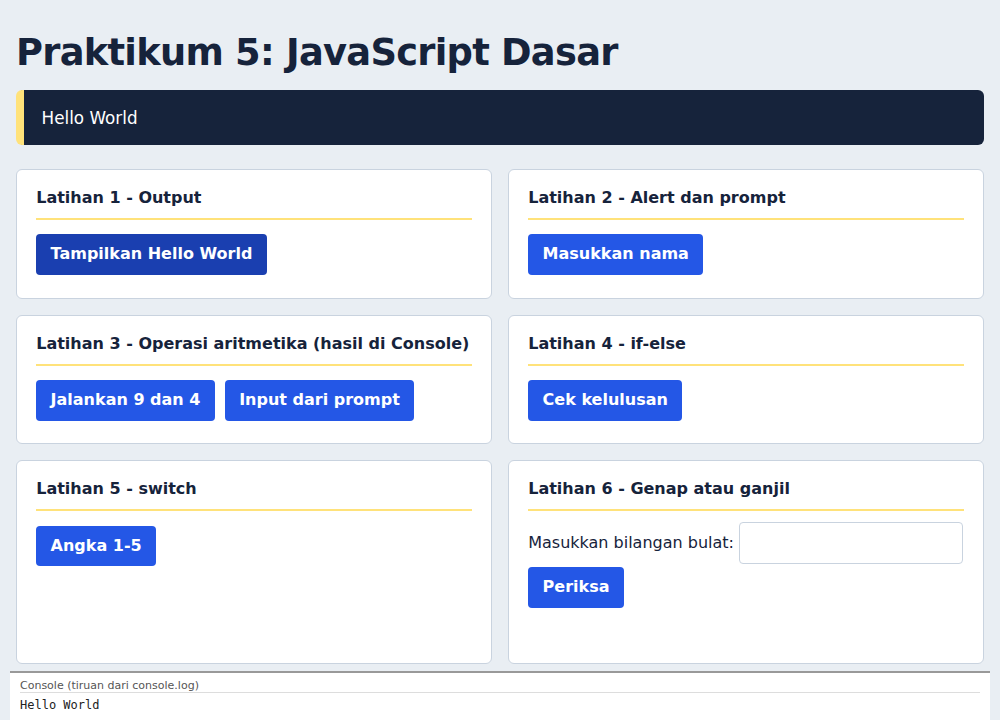

### Latihan 2 - Alert dan prompt
Diuji dengan nama diisi, input kosong, dan Cancel.

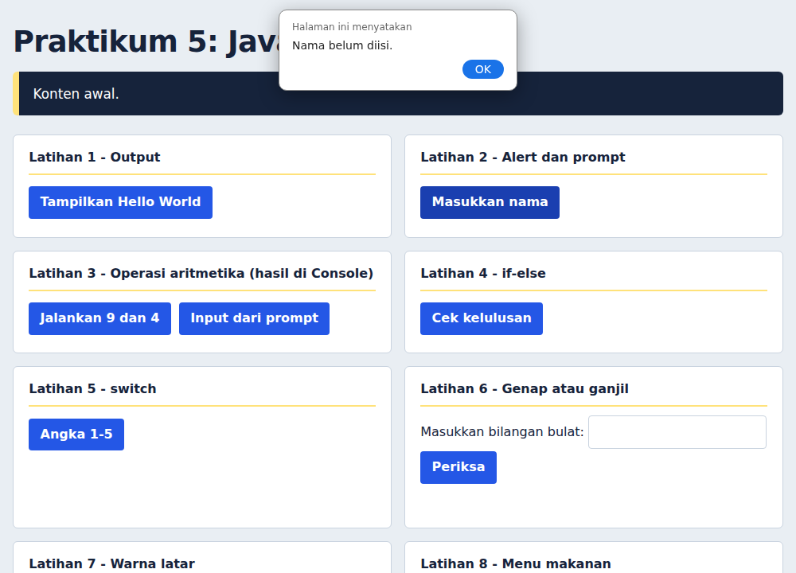

### Latihan 3 - Function operasi aritmetika
Hasil operasiDasar(9, 4) di Console.

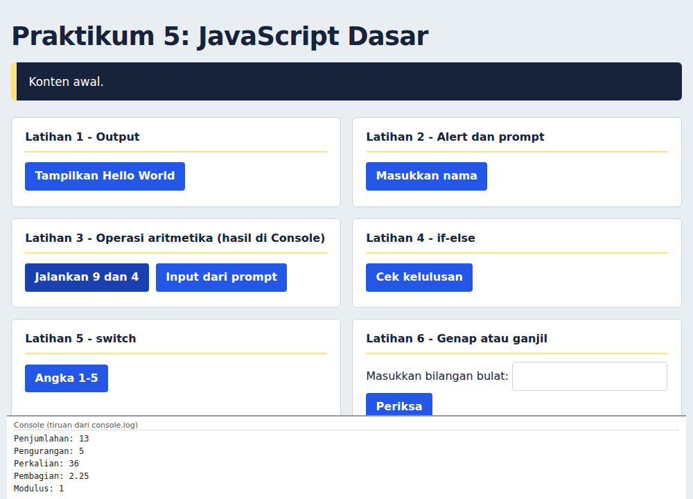

### Latihan 4 - if-else
Diuji dengan nilai 76 (lulus), 45 (belum lulus), dan 150 (tidak valid).

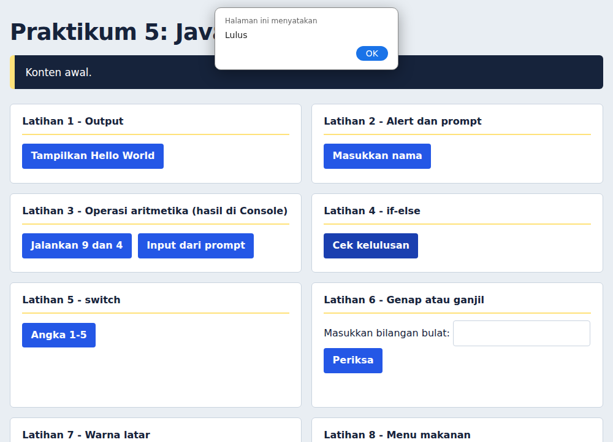

### Latihan 5 - switch
Diuji dengan angka 3 dan angka 9 (di luar pilihan).

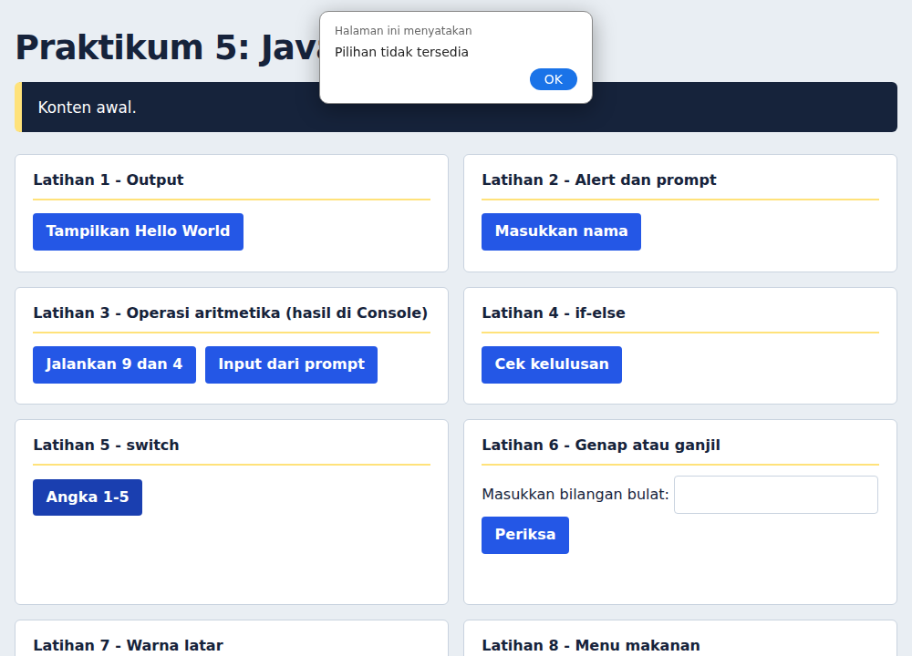

### Latihan 6 - Genap atau ganjil
Diuji dengan 8, -3, 0, 2.5, dan input kosong.

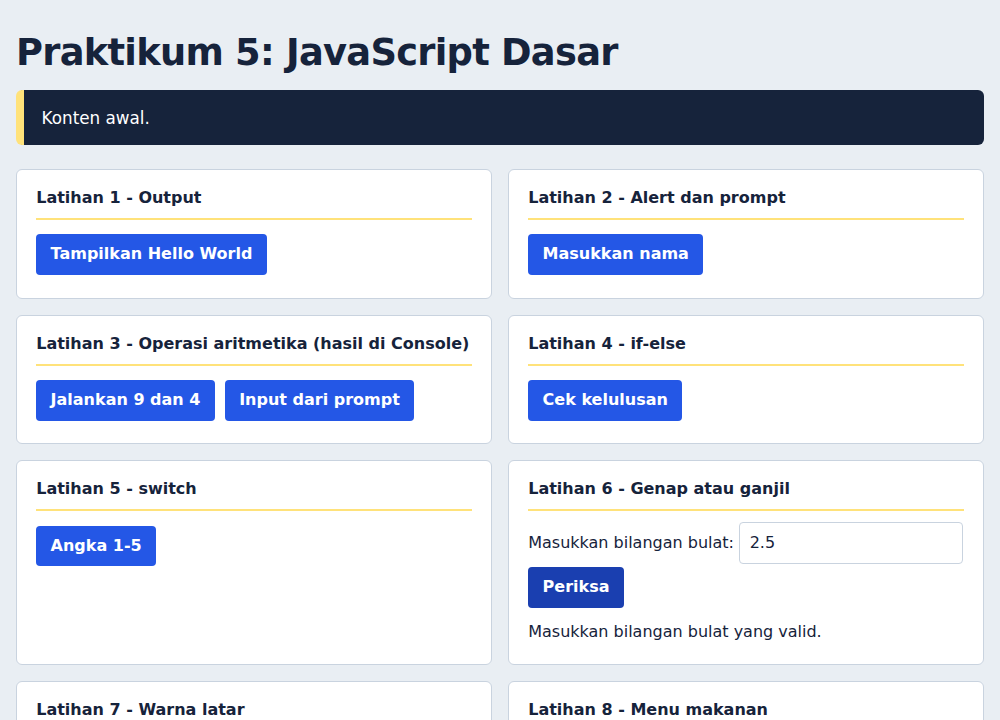

### Latihan 7 - Warna latar
Satu function ubahWarnaLatar(warna) dipakai oleh tiga tombol.

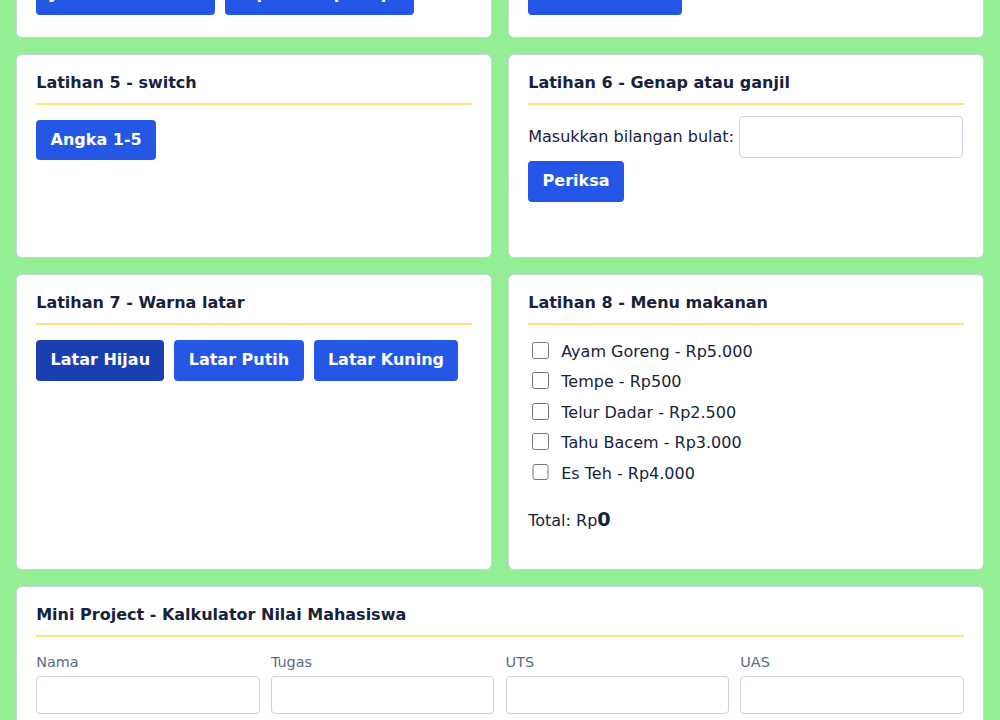

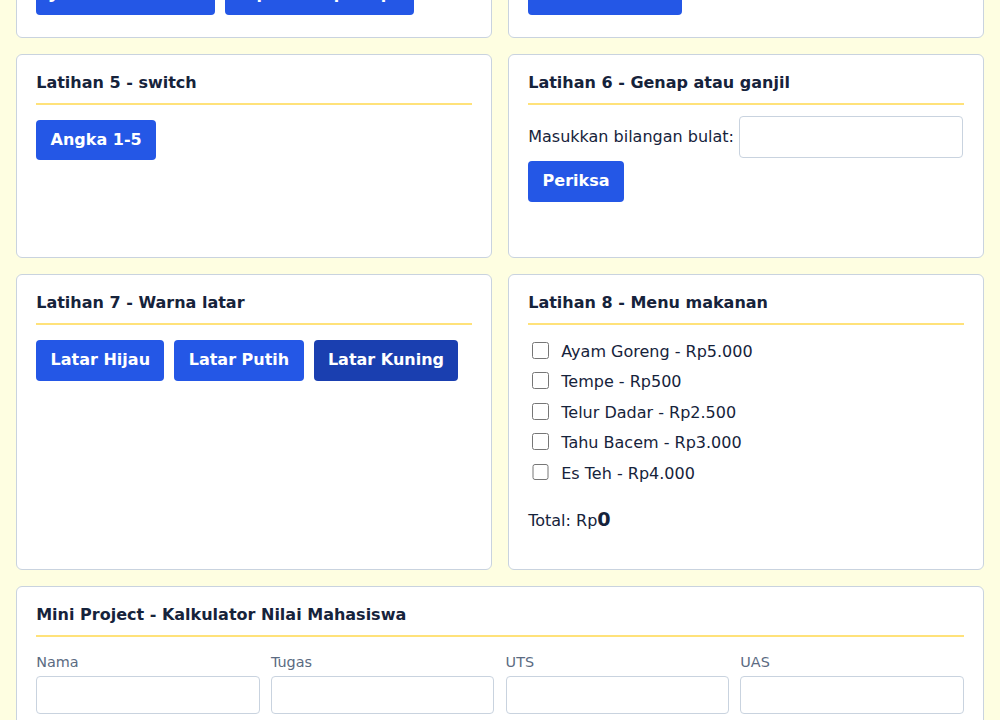

### Latihan 8 - Checkbox menu makanan
Total berubah otomatis saat checkbox dicentang.

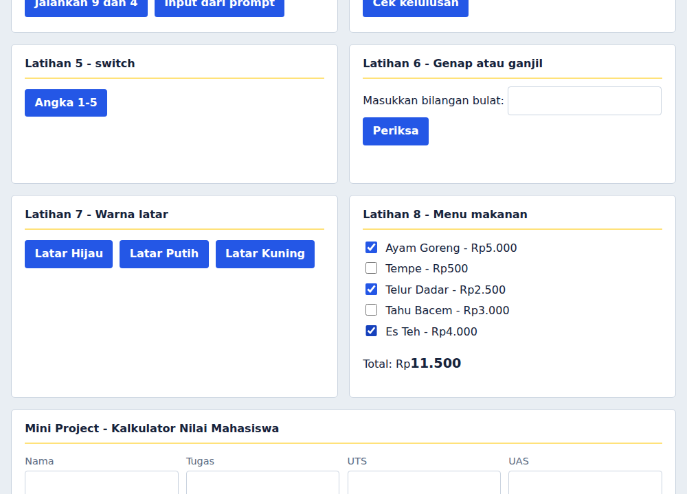

### Mini Project - Kalkulator Nilai
Tiga skenario nilai dan satu skenario input tidak valid.

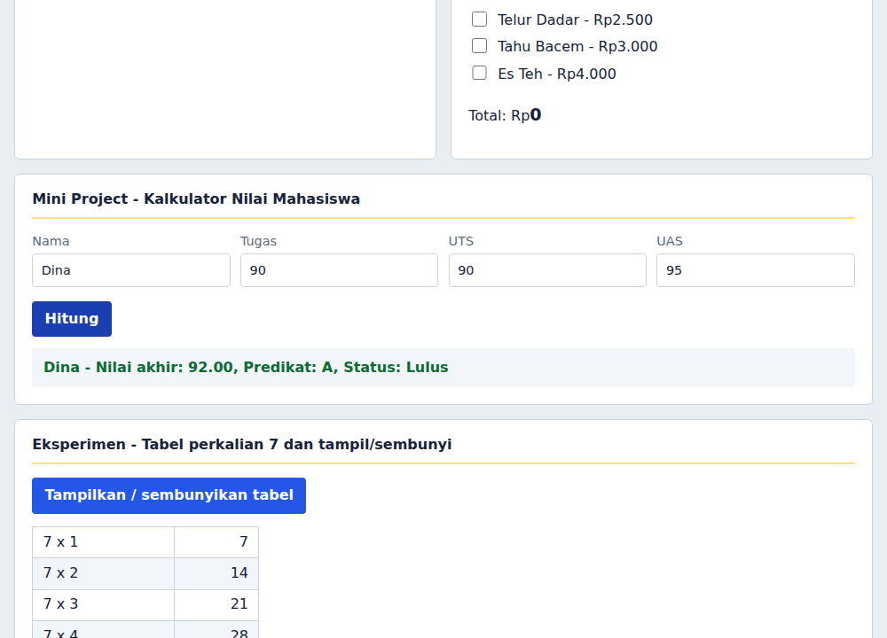

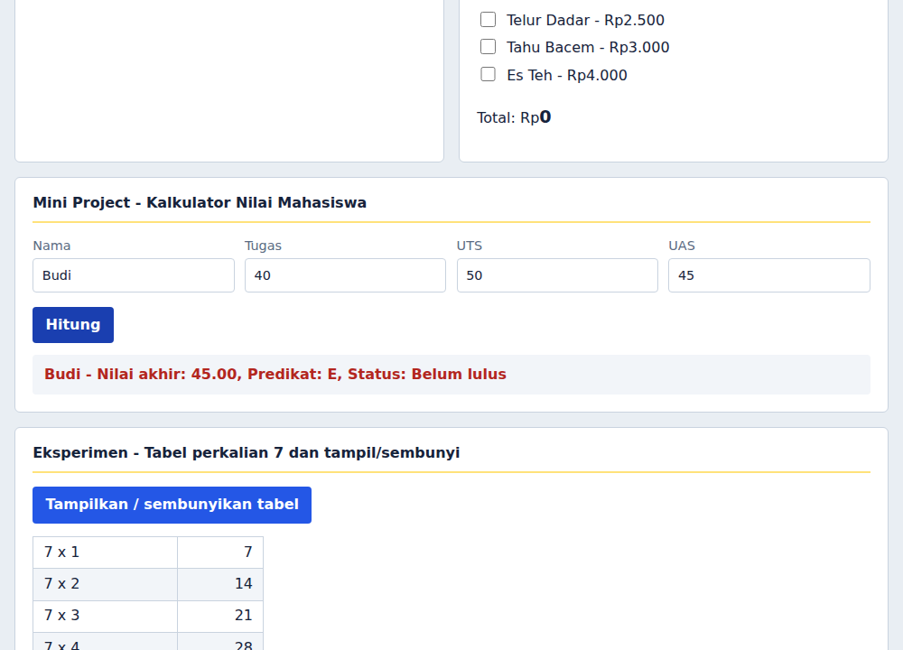

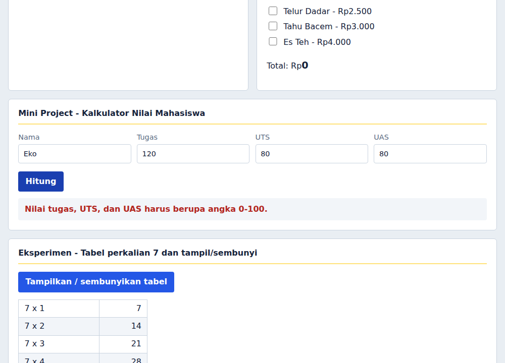

### Eksperimen mandiri - Tabel perkalian 7
Tabel perkalian 7 dengan tombol tampil/sembunyi.

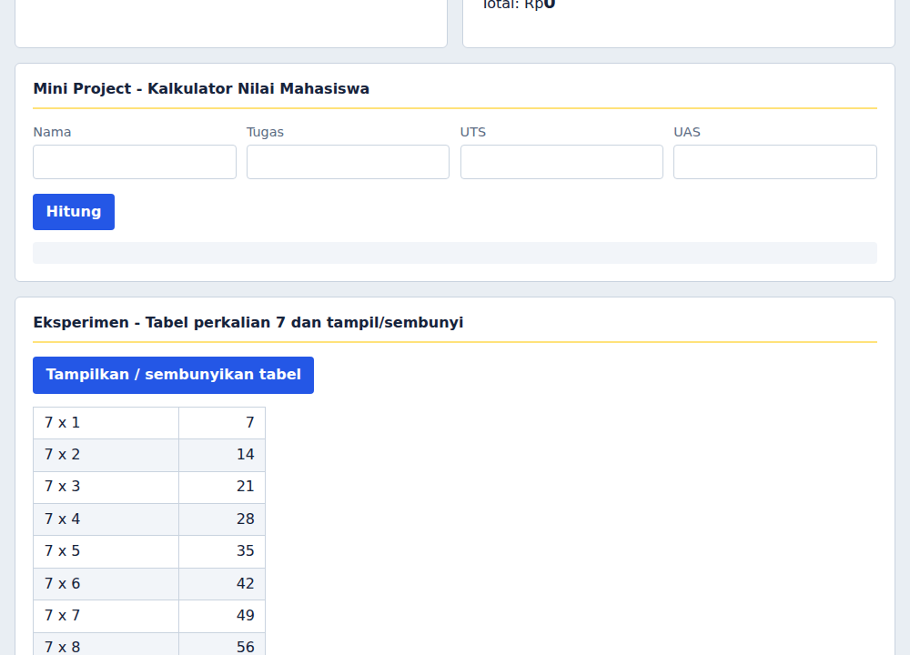

### Skenario uji mini project
| Tugas | UTS | UAS | Nilai akhir | Predikat | Status |
|---|---|---|---|---|---|
| 85 | 78 | 88 | 84.10 | B | Lulus |
| 90 | 90 | 95 | 92.00 | A | Lulus |
| 40 | 50 | 45 | 45.00 | E | Belum lulus |

## Jawaban pertanyaan
1. `console.log()` menulis pesan ke Console browser (untuk debugging, tidak terlihat pengguna). `alert()` menampilkan kotak pesan yang menghentikan eksekusi sampai ditutup. `prompt()` menampilkan kotak input dan mengembalikan string (atau `null` jika Cancel). `textContent`/`innerHTML` mengubah isi elemen di halaman; `textContent` memperlakukan isi sebagai teks biasa, `innerHTML` menafsirkan HTML.
2. `let` untuk variabel yang nilainya boleh diganti (`let umur = 20; umur = 21;`). `const` untuk nilai yang tidak ditetapkan ulang (`const nama = "Rani";`, `nama = "Dina"` akan error).
3. `==` membandingkan nilai dengan konversi tipe otomatis (`5 == "5"` bernilai true). `===` membandingkan nilai dan tipe tanpa konversi (`5 === "5"` bernilai false). `===` lebih aman.
4. `if-else` menguji kondisi logis atau rentang (mis. nilai >= 60). `switch` memilih satu tindakan dari beberapa nilai pasti (mis. pilihan menu "1", "2", "3").
5. Parameter adalah data masukan yang diterima function. `return` mengembalikan hasil ke pemanggil sehingga bisa disimpan atau diproses lagi.
6. `document.getElementById("id")` mencari elemen yang atribut `id`-nya sama dengan argumen dan mengembalikan objek elemen tersebut (atau `null` jika tidak ada), sehingga isi atau gayanya bisa diubah, mis. `.textContent` atau `.style.color`.
7. Validasi nama tidak kosong dan nilai 0-100 ada pada fungsi `tampilkanHasil()` dan `validNilai()` di `script.js` (bagian Mini Project).
